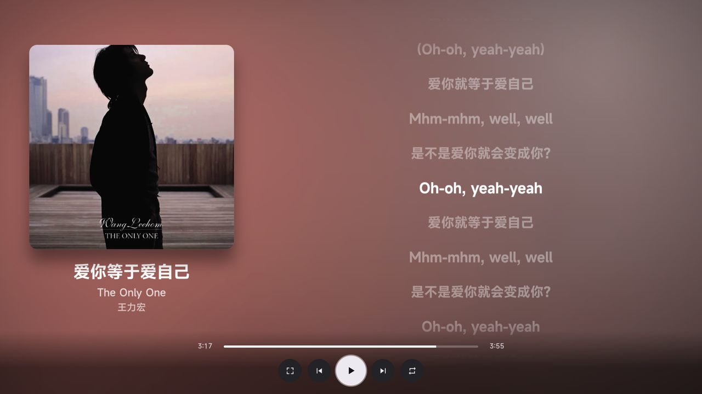
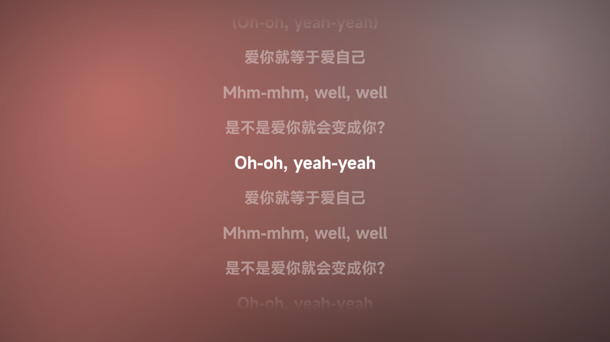
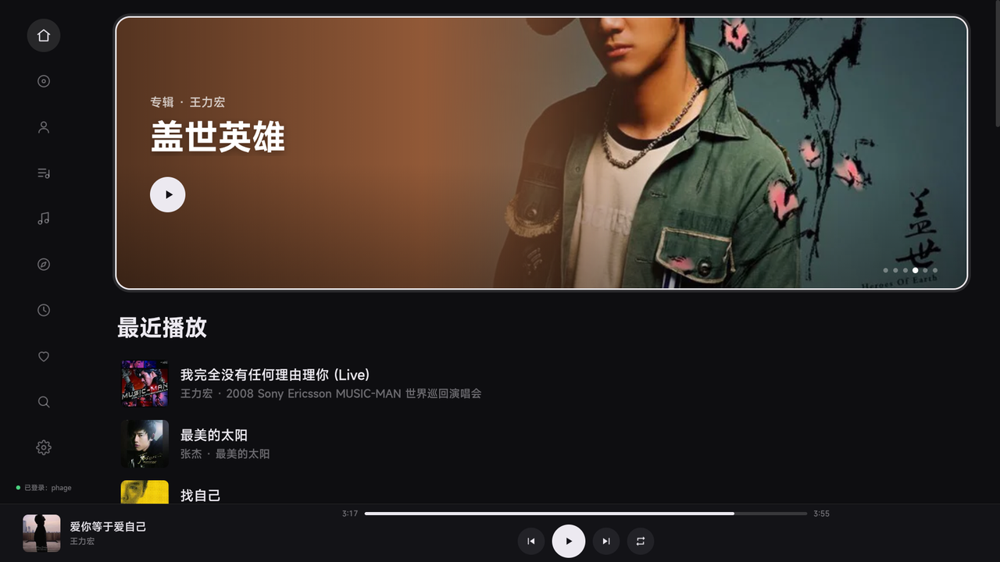
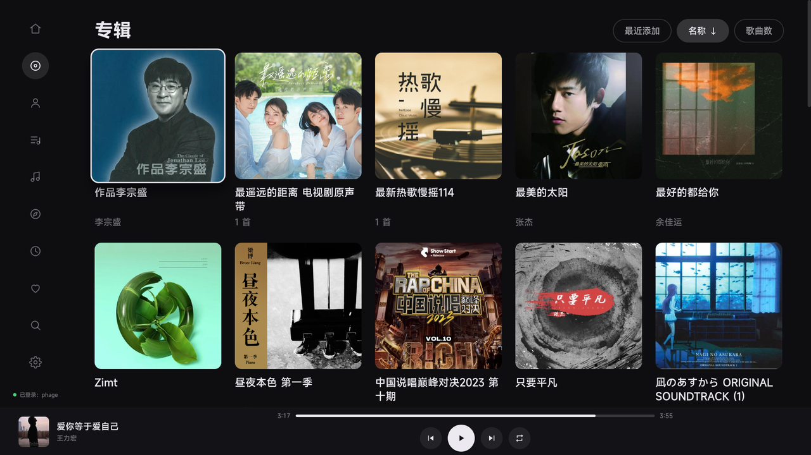
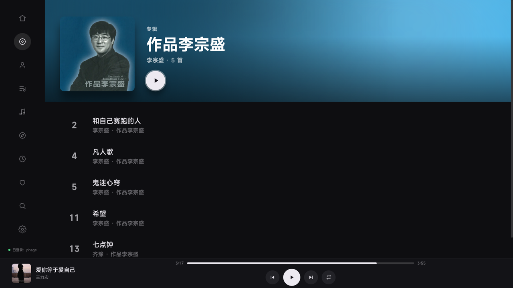
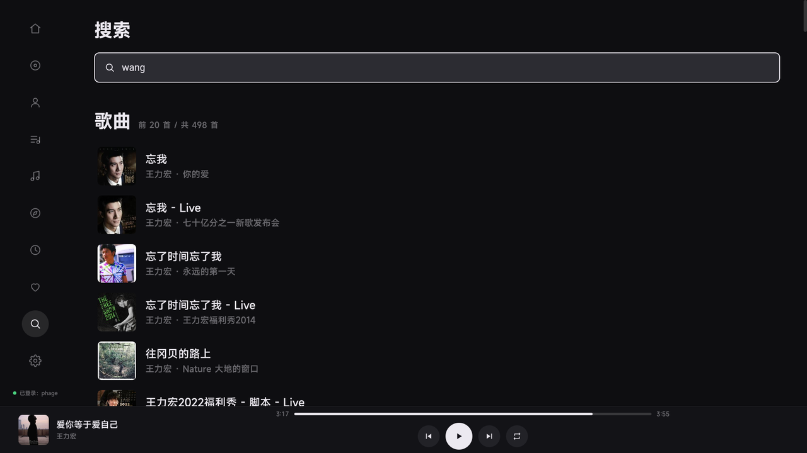
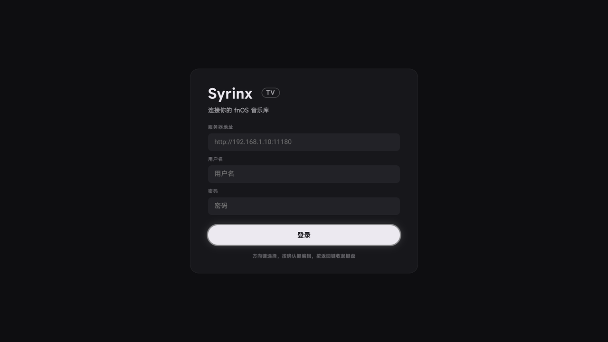

# Syrinx

An Android TV client for an **fnOS** (飞牛 OS) music library.

*Syrinx* is the name for a pan flute — and for the voice box of a songbird.

> Unofficial and third-party. Not affiliated with, endorsed by, or supported by
> the fnOS team. It talks to the same private HTTP API their web client uses.

English · [简体中文](README.zh-CN.md)

## Why

fnOS ships a good music web app, but it is built for a mouse: hover states, a
sidebar you have to hunt for, text inputs everywhere. On a TV with a remote it
is painful — and most TV browsers cannot sign the API requests anyway.

Syrinx keeps the library and the playback engine where they are and replaces
only the surface: a 1920×1080 interface moved entirely by arrow keys and OK,
with an on-screen keyboard for search and artwork-derived colour for the playing
page.

## Screenshots

| | |
|---|---|
|  |  |
| **Now playing** — the artwork picks the colour; the transport is a row of icons | **Full-screen lyrics** — one key cycles queue → lyrics → full screen |
|  |  |
| **Home** — one album up front, recent plays underneath | **Albums** — sort chips; press the active chip again to flip the direction |
|  |  |
| **Album detail** — the cover's tint carries into the header | **Search** — built-in keyboard; pinyin works |

## How it works

```
MainActivity ──► WebView ──► http://127.0.0.1:<port>/
                                  │
                                  ├─ /            bundled HTML/CSS/JS
                                  ├─ /_status     logged in?
                                  ├─ /_login      sign in, keep the token
                                  ├─ /_logout
                                  ├─ /_config     server address
                                  └─ /api/*       signed and forwarded to fnOS
```

The UI cannot load from `file://`, because then every API call would be a
cross-origin request against a server that sets no CORS headers. Binding a
loopback `ServerSocket` gives the page and the API one origin, so the page can
just `fetch('/api/...')`. The request signature lives in the Java layer
(`Api.java`), so the page never sees the key.

The proxy only ever talks to the host you configured, and only on loopback.

## Requirements

| | |
|---|---|
| Device | Android TV / set-top box, Android 7.0+ (minSdk 24). Tested on Android 9 with a Chrome 66 WebView. |
| Server | An fnOS instance with a music library, reachable from the TV over the LAN |
| Build | JDK 17, Android SDK command-line tools: build-tools 34.0.0 and platform android-28 |

There is no Gradle. `build.sh` drives `aapt2`, `javac`, `d8`, `zip`, `zipalign`
and `apksigner` directly, which keeps the build a few seconds long and the repo
free of a build system.

## Build

```sh
./build.sh
# ==> done: build/syrinx.apk
```

Override the auto-detected toolchain if yours lives elsewhere:

```sh
ANDROID_SDK=/path/to/android-sdk JAVA_HOME=/path/to/jdk-17 ./build.sh
```

Signing uses the standard Android debug keystore by default. For a release key:

```sh
SYRINX_KEYSTORE=~/keys/release.keystore \
SYRINX_KEY_ALIAS=syrinx \
SYRINX_KEYSTORE_PASS=... \
SYRINX_KEY_PASS=... \
./build.sh
```

Keystores and passwords are git-ignored. Never commit one.

## Install

```sh
adb connect <tv-ip>:5555
adb install -r build/syrinx.apk
```

The app appears in the TV launcher under **Syrinx**.

## First run

Enter the fnOS address (`http://192.168.x.x:port`), your username and password.
The address and the session token are stored in `SharedPreferences`; the
password itself never is. `Back` closes the keyboard.



## Controls

| Key | Action |
|---|---|
| ↑ ↓ ← → | Move focus |
| OK | Activate / play |
| Back | Leave the playing page, then the detail page, then the section |
| Menu / Info | Jump to the playing page, or back out of it |
| ⏯ ⏭ ⏮ ⏹ | Play-pause, next, previous, stop (media keys) |

The playing page keeps the transport bar out of the way until you touch the
remote: with the bar away, ← → scrub ten seconds, and any arrow key or OK brings
the bar back for five seconds.

Search uses a built-in on-screen keyboard rather than the TV's IME, because
several TV keyboards render nothing usable on a remote. Pinyin works — the
server's search endpoint accepts it — so a Latin keyboard is enough.

## Project layout

```
AndroidManifest.xml        activity, leanback launcher entry, orientation
build.sh                   no-Gradle build
src/com/phage/syrinx/
  MainActivity.java        WebView host, key mapping, TV bridge
  ProxyServer.java         loopback HTTP server: static files + API proxy
  Api.java                 request signing (md5 salt + key, nonce, timestamp)
  Prefs.java               SharedPreferences: host, token, user, device id
assets/
  index.html               single page shell
  style.css                the whole design system, tuned for Chrome 66
  app.js                   rendering, D-pad focus navigation, playback
res/                       launcher icon and TV banner
docs/screenshots/          the images above
```

The page targets Chrome 66 on purpose (Android 9's WebView): no `flex gap`, no
`inset`, no `backdrop-filter`, no `min()` / `max()`, no optional chaining.

## API notes

Endpoints used, all under `/music/api/v1`: `album/list`, `artist/list`,
`track/list`, `playlist/list`, `search/{track,album,artist,playlist}`,
`album/detail`, `artist/detail`, `playlist/detail`,
`track/{album-detail,artist-detail,playlist-detail}/list`, `lyric/list`,
`play-history/list`, `favorite-track/list`, `track/transcode`, and the
`track/roam-{start,next,previous}` session used by the roam page.

Each request carries an `authx` header: `nonce`, `timestamp` and an md5
signature over the canonicalised query (keys sorted, percent-decoded) plus a
salt and key taken from the public web client bundle. Those two constants are
reverse-engineered, sit in `Api.java`, and will need updating if fnOS changes
them.

Traffic is plain HTTP on your LAN, and the app declares
`usesCleartextTraffic="true"`. Do not expose an fnOS instance to the internet
and expect this client to be the secure part of the chain.

## Limitations

- UI strings are Chinese only.
- Tested against one fnOS version and one TV; the layout assumes 1920×1080.
- No offline cache, no gapless playback, no lyrics editing.
- The library is read through the fnOS API — nothing is stored on the device.

## License

[MIT](LICENSE).
