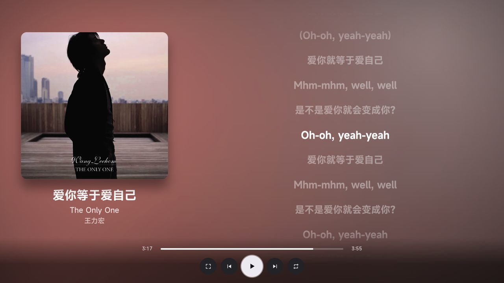
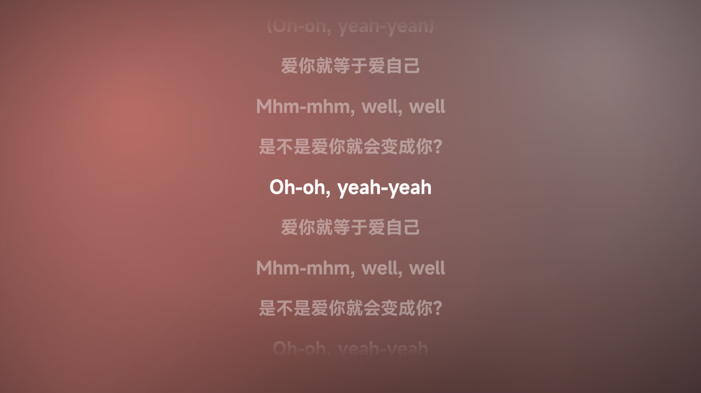
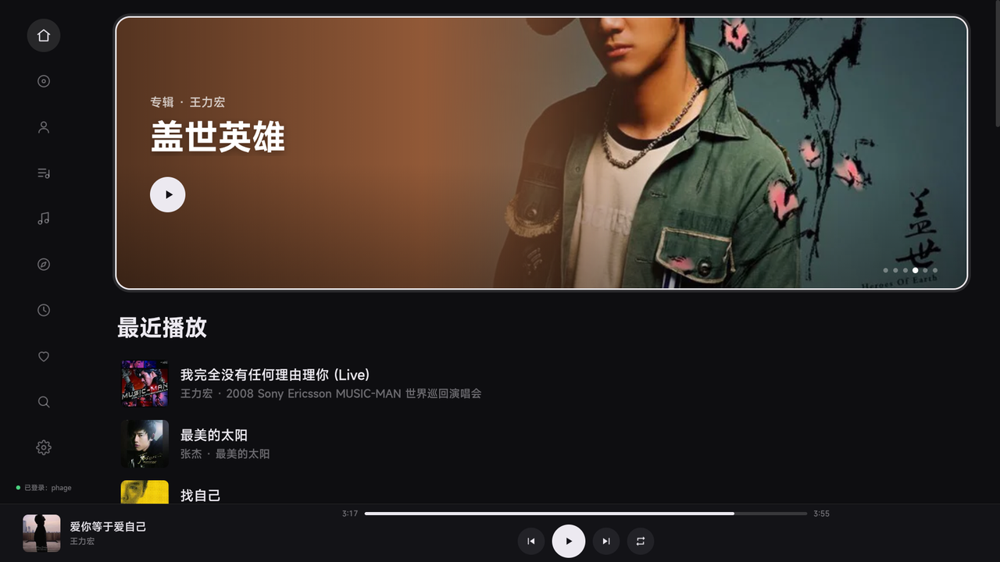
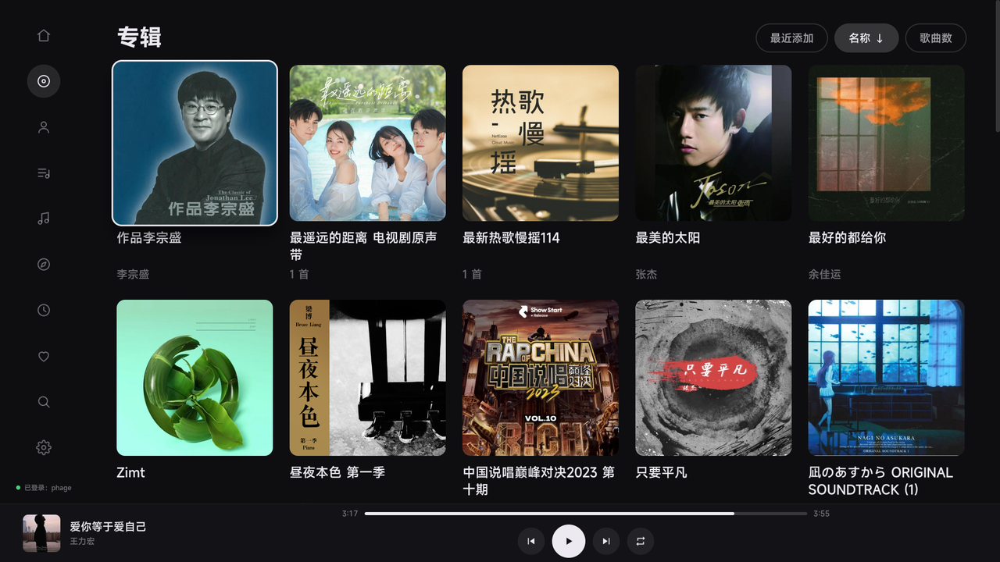
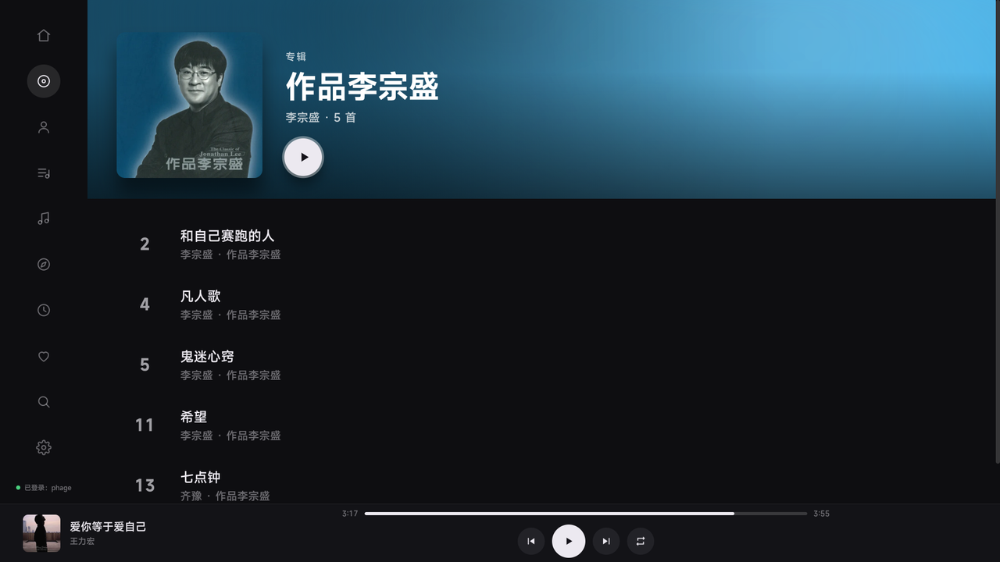
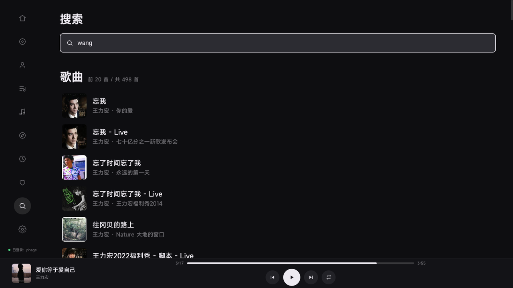
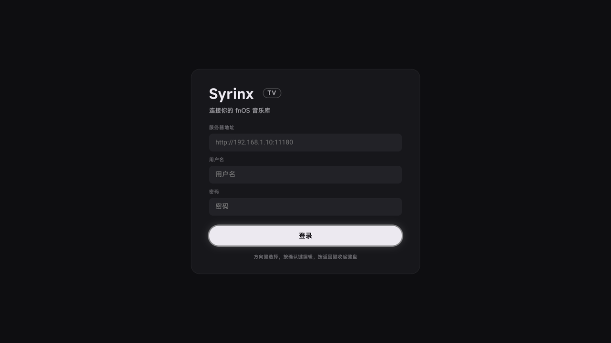

# Syrinx

给 **fnOS（飞牛 OS）** 音乐库用的 Android TV 客户端。

*Syrinx* 是排箫的名字，也是鸣禽的发声器官。

> 非官方第三方项目，与 fnOS 官方无关，也不由其维护。它调用的就是 fnOS 网页客户端
> 自己用的那套私有 HTTP 接口。

[English](README.md) · 简体中文

## 为什么做这个

fnOS 自带的音乐网页做得不错，但它是给鼠标设计的：悬停态、要自己去找的侧边栏、
满屏的输入框。换成电视遥控器就很难受，而且多数电视浏览器没法给 API 请求签名。

Syrinx 不动音乐库和播放引擎，只把界面换掉：1920×1080、纯方向键加确认键、搜索用
内置屏幕键盘、播放页的配色取自专辑封面。

## 界面

| | |
|---|---|
|  |  |
| **播放页** — 配色取自专辑封面，传输条只有一排图标 | **全屏歌词** — 一个按键循环 接下来 → 歌词 → 全屏 |
|  |  |
| **首页** — 一张大图开头，下面是最近播放 | **专辑** — 排序切换；再按一次当前项就是反序 |
|  |  |
| **详情页** — 封面的色调延伸到头图 | **搜索** — 内置键盘，支持拼音 |

## 它是怎么工作的

```
MainActivity ──► WebView ──► http://127.0.0.1:<port>/
                                  │
                                  ├─ /           内置的 HTML/CSS/JS
                                  ├─ /_status    是否已登录
                                  ├─ /_login     登录，保存 token
                                  ├─ /_logout
                                  ├─ /_config    服务器地址
                                  └─ /api/*      签名后转发给 fnOS
```

页面不能从 `file://` 加载：那样每个 API 调用都是跨域请求，而服务端并不返回 CORS
头。在回环地址上开一个 `ServerSocket`，页面和接口就成了同源，页面里直接
`fetch('/api/...')` 即可。签名逻辑留在 Java 层（`Api.java`），页面拿不到密钥。

代理只连你配置的那台服务器，且只监听回环地址。

## 环境要求

| | |
|---|---|
| 设备 | Android TV / 电视盒子，Android 7.0+（minSdk 24）。实测于 Android 9 + Chrome 66 WebView |
| 服务端 | 一台装了音乐库、且电视能通过局域网访问到的 fnOS |
| 构建 | JDK 17，Android SDK 命令行工具：build-tools 34.0.0 与 platform android-28 |

项目不用 Gradle。`build.sh` 直接调用 `aapt2`、`javac`、`d8`、`zip`、`zipalign`
和 `apksigner`，构建只要几秒，仓库里也不用带一套构建系统。

## 构建

```sh
./build.sh
# ==> done: build/syrinx.apk
```

工具链装在别处的话可以覆盖：

```sh
ANDROID_SDK=/path/to/android-sdk JAVA_HOME=/path/to/jdk-17 ./build.sh
```

默认用标准的 Android debug keystore 签名。要打正式包：

```sh
SYRINX_KEYSTORE=~/keys/release.keystore \
SYRINX_KEY_ALIAS=syrinx \
SYRINX_KEYSTORE_PASS=... \
SYRINX_KEY_PASS=... \
./build.sh
```

keystore 和口令都在 git 忽略列表里，不要提交。

## 安装

```sh
adb connect <电视IP>:5555
adb install -r build/syrinx.apk
```

装好后在电视桌面里叫 **Syrinx**。

## 首次启动

填 fnOS 地址（形如 `http://192.168.x.x:端口`）、用户名和密码。地址和登录 token
存在 `SharedPreferences` 里，密码不保存。按返回键收起键盘。



## 按键

| 按键 | 作用 |
|---|---|
| ↑ ↓ ← → | 移动焦点 |
| 确认 | 进入 / 播放 |
| 返回 | 先退出播放页，再退详情页，再退板块 |
| 菜单 / 信息 | 直接进播放页，再按一次退回 |
| ⏯ ⏭ ⏮ ⏹ | 播放暂停、下一首、上一首、停止（媒体键） |

播放页的传输条默认收起，不抢画面：收起状态下 ← → 前后跳十秒，按方向键或确认键会把
传输条唤回来，五秒后再次收起。

搜索用的是内置屏幕键盘，不用系统输入法——不少电视输入法在遥控器下根本弹不出可用
键盘。接口本身支持拼音，所以拉丁键盘够用。

## 目录结构

```
AndroidManifest.xml        入口 Activity、Leanback 桌面入口、横屏
build.sh                   无 Gradle 构建
src/com/phage/syrinx/
  MainActivity.java        WebView 宿主、按键映射、TV bridge
  ProxyServer.java         回环 HTTP 服务：静态文件 + API 代理
  Api.java                 请求签名（md5 salt + key、nonce、时间戳）
  Prefs.java               SharedPreferences：地址、token、用户、设备 ID
assets/
  index.html               单页外壳
  style.css                整套视觉规范，按 Chrome 66 手写
  app.js                   渲染、方向键焦点导航、播放
res/                       桌面图标与 TV banner
docs/screenshots/          上面用到的截图
```

页面按 Chrome 66（Android 9 的 WebView）写的，刻意不用 `flex gap`、`inset`、
`backdrop-filter`、`min()` / `max()` 和可选链。

## 接口说明

用到的接口都在 `/music/api/v1` 下：`album/list`、`artist/list`、`track/list`、
`playlist/list`、`search/{track,album,artist,playlist}`、`album/detail`、
`artist/detail`、`playlist/detail`、
`track/{album-detail,artist-detail,playlist-detail}/list`、`lyric/list`、
`play-history/list`、`favorite-track/list`、`track/transcode`，以及漫游页用的
`track/roam-{start,next,previous}` 会话。

每个请求带一个 `authx` 头：`nonce`、`timestamp`，以及对规范化查询串（键排序、
先百分号解码）加 salt、加 key 的 md5 签名。这两个常量取自 fnOS 网页客户端的公开
前端包，属于逆向所得，写在 `Api.java` 里；fnOS 一旦更换它们，这里就要跟着改。

流量在局域网内走明文 HTTP，应用声明了 `usesCleartextTraffic="true"`。不要指望把
这个客户端当成整条链路上的安全环节。

## 已知限制

- 界面只有中文。
- 只在一个 fnOS 版本、一台电视上验证过，布局按 1920×1080 设计。
- 没有离线缓存、没有无缝播放、没有歌词编辑。
- 音乐库全部通过 fnOS 接口读取，设备上不落库。

## 许可证

[MIT](LICENSE)。
